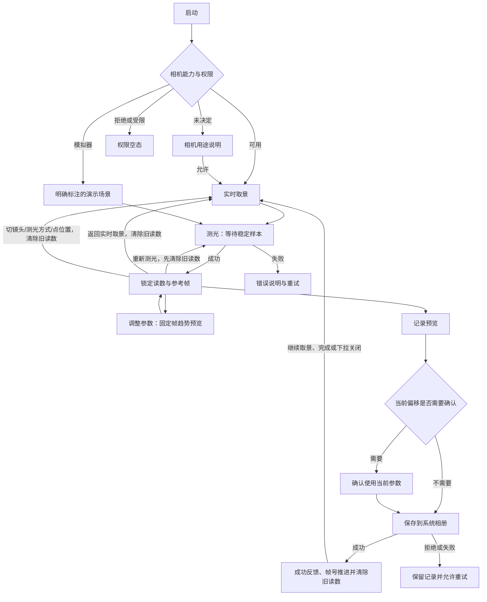

# LumaFrame 光格：产品与交互规格

版本：重设计开发版 0.1 · 日期：2026-11-02

本文描述本轮目标行为和验收标准。[06 · UI 视觉与交互重设计](06-UI视觉与交互重设计.md) 保留为原始方向规格；用户后续明确反馈图标与整体 UI 过大，当前紧凑尺寸以本文为准，覆盖 06 中原 52pt HERO、76pt 测光按钮等大尺寸数值。工程完成度以实际验证记录为准；未执行的真机与无障碍检查不可标记通过。

## 1. 产品边界与默认值

面向胶片拍摄现场，帮助用户得到曝光组合、理解曝光偏移并保存参考记录。首发范围是 iPhone、iOS 17+、竖屏优先、离线运行。iOS 26 使用原生 Liquid Glass，iOS 17–25 保持系统材质和标准按钮回退。无账号、无后端、无运行时 AI，不读取用户已有照片，不申请麦克风或定位。

| 项目 | 默认值与约束 |
|---|---|
| 曝光模式 | A 光圈优先 |
| 胶片 ISO | 400；作为胶卷属性手动设置 |
| 胶片类型 | 彩色负片；可选反转片、黑白负片 |
| 曝光补偿 | 0EV；正值表示希望增加曝光 |
| 校准偏移 | 0EV；未完成设备校准 |
| 参数档位 | 使用离散摄影档位；显示数值与内部计算值一致 |
| 镜头与倍率 | 默认广角 1×；按硬件显示后置超广角/长焦，支持时提供 2×数码裁切；演示仅 1×/2×图像裁切 |
| 网格 | 开启，可在设置关闭 |
| 主题 | 主测光界面固定深色；胶卷、曝光、记录与设置弹层默认跟随系统，也可选择浅色或深色，选择本地持久化 |
| 测光方式 | 默认矩阵，可选中央重点和点测光；方式本地持久化，独立于 A/M/S 曝光模式 |
| 点测位置 | 启动回到画面中心；圆区直径为可见画面短边的 16%，圆心受边界约束 |
| 保存位置 | 系统相册最近项目；只申请添加权限 |
| 数据持久化 | 用户设置与帧号本地保存；不建立历史照片数据库 |

## 2. 信息架构

主界面是固定深色的现场测光台，不显示占据取景上方的标题导航栏。全宽取景顶部左侧为胶卷短名与 ISO 胶囊，右侧为设置；下缘为测光方式、DEMO、AE-L 与镜头胶囊。取景下方以黑底仪表区显示曝光偏移、光圈/快门、刻度拨盘和低频选项。底栏是记录缩略图、圆形测光按钮及返回实时/点位入口。胶卷、曝光说明、设置与记录均使用系统 Sheet，保留原生导航和工具栏。



## 3. 主界面线框

```text
┌────────────────────────────────┐
│ [负片 · 400]          [设置]  │
│                                │
│       全宽取景 / 锁定参考帧     │
│       ◯ 点测区域（点测时）      │
│                                │
│ [矩阵 ▾]       [DEMO] [AE-L]  │
│         [可用镜头 / 倍率]       │
├────────────────────────────────┤
│ EV 12.0    −3 ···│··· +3      │
│    f/5.6          1/500         │
│    光圈           快门 · 自动   │
│ ‹  ┆ ┆ ╎ ┆ ┃ ┆ ╎ ┆ ┆  ›       │
│     4    5.6    8    11        │
│ [A 光圈优先 ▾] [±0.0 EV]      │
│ [记录缩略图]    (测光)    [↺]  │
└────────────────────────────────┘
```

这是结构线框。普通字号下，宽度不足 390pt **或**可用高度不足 740pt 时采用小屏布局。取景以全宽 3:4 为基准，为仪表与操作区（含底栏）预留小屏 328pt、其余 344pt，目标是首屏同时可见取景、主读数、拨盘和底栏。主读数行高为小屏 64pt、其余 70pt；测光按钮外径为 64/68pt，记录缩略图为 44pt。底栏保留安全区。辅助字号单独使用 260pt 取景和可滚动仪表区，不沿用普通字号的固定行密度。

取景下缘的测光方式 Menu 与 A/M/S 曝光模式菜单彼此独立。锁定画面用 2pt 琥珀描边和 AE-L 表示，描边避开状态栏与屏幕圆角，仅覆盖安全区以下的取景区域。AE-L 使用与 DEMO 同高的 22pt 描边徽标，不使用按钮玻璃外观，只表示锁定状态，点击底栏右侧返回按钮清除读数。镜头说明只在切换后短暂显示，不常驻遮挡画面。ISO 移到胶卷入口；M 的“采用 f/…·…”胶囊仅在有效测光后出现，普通字号时与模式、补偿同排。相机授权/错误说明按内容展示，支持恢复路径。竖屏优先，不要求横屏相机体验。

EV 与曝光偏移刻度固定在 ScrollView 外。辅助字号下 HERO 光圈/快门改为纵向标签—值列表，标签使用 body 并限制到 xxxLarge，数值保持 42pt 半粗体及更高对比度，确保值比标签醒目；StopDial 刻度数字与胶囊字号上限为 xxxLarge。胶囊纵向排列，仪表正文显示系统滚动条，底部额外保留 16pt 滚动留白并由独立底栏占位，保证最后一项能完整滚出。关键数值和保存按钮不以截断文字换空间；取景的少量状态徽标保留完整辅助名称。参考帧按当前容器中心裁切，`updateViewfinderAspect` 继续保证记录与测光的可见范围一致。

### 3.1 视觉体系

- 当前视觉基准为“暗房测光台”：固定黑底、全宽无圆角取景、黑底仪表与相机式操作行，替代此前的浅色分组页面。
- 全局 tint 为琥珀色，选中读数、锁定边框和点测圆使用琥珀；读数与拨盘不加玻璃。iOS 26 的悬浮控件使用 `glassEffect` 与 `GlassEffectContainer`，相邻控件保持清楚的独立命中区。
- 普通字号 HERO 使用 rounded 系统数字，小屏 36pt、其余 42pt；数字等宽并按减少动态效果设置使用 numericText 或静态更新。辅助字号切换为标签—值列表，不强制压成普通双列。说明采用系统 Dynamic Type。
- 仪表水平边距约 16pt，取景横向贴边；分组内容依层级留白，不再给每块内容同等卡片权重。
- 可点控件命中区域至少 44×44pt。可调参数整体可点；自动参数保持只读，点按反馈不切换编辑器或模式。
- 胶囊的普通视觉高度约 34pt，外部命中区至少 44pt；`LF.chip` 使用可缩放 footnote，最小内容高度 34pt，辅助字号可自然增高。设置图标 18pt、返回图标 16pt；DEMO 普通徽标高 22pt、文字 9pt，完整“演示场景，非实测”语义标签保留。
- 风险同时使用图标、文案和颜色。中性、提示、较大偏移的区别不能只靠红绿。
- 主页面始终深色；设置中的外观只影响弹层。浅色弹层的文字和次级文本按钮使用语义前景，琥珀实心主按钮使用黑字，避免浅底上的浅色文字。
- A/M/S 始终使用 Menu；参数与 ISO 使用同一个原生吸附刻度拨盘。胶卷为三张选择卡，设置保留系统 Form，记录采用系统导航工具栏与固定底部主按钮。
- iOS 17–25 的悬浮区域使用系统 material 和标准按钮；降低透明度时使用实底回退。减少动态效果时避免非必要过渡，所有信息在关闭动画后仍完整可用。新视觉的功耗与辅助功能效果仍须按验证矩阵检查。

系统 API 依据：[Apple：为自定义视图应用 Liquid Glass](https://developer.apple.com/documentation/swiftui/applying-liquid-glass-to-custom-views)、[Apple：glassProminent 按钮样式](https://developer.apple.com/documentation/swiftui/primitivebuttonstyle/glassprominent)。

### 3.2 状态条

| 状态 | 显示 | 主要动作 |
|---|---|---|
| 实时取景 | 仪表行提示“对准主体，按下测光” | 测光 |
| 等待稳定 | 主按钮进度反馈；暂时不可重复触发 | 等待或超时重试 |
| 已锁定 | 琥珀边框、AE-L，仪表区显示 EV 与曝光偏移 | 调参、重新测光、记录或返回实时 |
| 演示模式 | DEMO 徽标；VoiceOver 朗读“演示场景，非实测” | 体验交互；记录也保留演示标识 |
| 相机不可用 | 原因与重试入口 | 重试；必要时去系统设置 |
| 保存中 | “正在保存…” | 防止重复提交 |

## 4. 参数与模式

### 4.1 胶卷设置

点击取景左上胶卷胶囊打开支持 medium / large 两档高度的 Sheet，presentationBackground 使用不透明的系统背景色，半屏时不透出取景内容。胶片类型为“彩负 / 反转 / 黑白”三张带色块的选择卡，选中项同时显示边框和勾选。普通字号色块高 36pt、内部间距 8pt、内边距 10pt；辅助字号改为纵向排列，保留更宽松的内部间距。ISO 使用同一 StopDial 组件和明确数值，沿用实际 ISO 档位，经 `model.setISO` 调整。ISO 对应当前胶卷或采用的曝光指数，调整后不会改变已锁定场景的原始 EV100；它会重新计算胶片 ISO 下的目标曝光与参数偏移。

切换胶片类型只改变经验提醒，不自动增加或减少曝光。正负片差异不等于具体品牌和冲扫工艺的完整模型。

### 4.2 三种曝光模式

| 模式 | 用户控制 | 自动计算 | 重新测光后 |
|---|---|---|---|
| A 光圈优先 | ISO、光圈、补偿 | 快门 | 保留 ISO/光圈，按新读数更新快门 |
| S 快门优先 | ISO、快门、补偿 | 光圈 | 保留 ISO/快门，按新读数更新光圈 |
| M 手动 | ISO、光圈、快门 | 仅建议，不应用 | 保留所有手动值，只更新读数与建议 |

模式入口始终可见并带可理解的辅助功能名称。切换到 M 保留当前组合。切换到 A/S 后，仅在已有有效测光快照时求解自动项。无有效读数时不展示伪造的自动推荐。编辑器随模式选中可调参数：A 为光圈，S 为快门；从本地设置恢复模式时采用相同规则，避免启动后落在自动项上。

M 模式提供“采用建议”。只有用户明确触发该动作，才把建议组合应用到当前参数。补偿不会暗中改动 M 参数；M 的曝光意图通过直接调节参数表达。

### 4.3 单参数编辑

点击可调光圈或快门读数选择编辑项目，选中数字与短下划线呈琥珀色。拨盘是原生横向 ScrollView，按离散档位吸附到固定中线，整档刻度带数字；左右 chevron 提供单档位步进，VoiceOver 可用 adjustable 上下滑调节，不依赖拖动。光圈/快门每次移动一个标称 1/3 档。程序化定位、初始化和界面布局不得回写参数。自动列标“自动”并保持只读，未测光时显示“—”；点按不抢占拨盘、不切模式。只有用户明确进入 M，才可手动编辑两项。

当自动求解超出器材范围时，使用边界值并显示“已到参数边界”。不得把边界组合标成准确达到目标。界面保留实际 EV 偏移，给出可理解的建议，例如调整光圈、快门、补偿或重新测光。

### 4.4 补偿与校准

曝光补偿是本次拍摄意图。A/S 下 `+1EV` 表示让求解结果比中性测光多曝光一档；风险仍显示相对中性测光的 `+1EV`，不会因为选择了补偿而归零。

仪表下方的补偿胶囊始终显示当前正负数值，非零时增加琥珀描边。点击把同一个刻度拨盘切到补偿，在 −3 至 +3EV 内按 1/3 档调整；长按菜单提供“归零”和“补偿说明”。原生“曝光”Sheet 保留 Stepper 与归零操作，支持半屏/全屏，并解释场景 EV100、当前偏移、目标补偿的区别。M 模式明确说明只有“采用建议”才应用补偿。调整即时生效并本地保存，关闭面板不撤销；App 设置中不重复放置补偿控件。

校准是设备读数修正，位于设置页，单独说明。正校准值加到 EV100：读数更高，在相同 ISO 与手动项下推荐曝光量减少；这与正创作补偿的方向不同。当前实现修改校准后清除旧读数与趋势图，要求重新测光。

## 5. 测光与趋势预览

### 5.1 测光方式与点选

取景下缘 Menu 提供“矩阵测光 / 中央重点 / 点测光”。它决定从画面哪些区域读取亮度，与决定哪个参数自动计算的 A/M/S 曝光模式相互独立。

| 测光方式 | 当前实现 | 交互 |
|---|---|---|
| 矩阵测光 | 将整个可见裁切区域划为 48×64 等面积区域，对各区域线性亮度均值等权汇总 | 使用整个可见取景范围 |
| 中央重点 | 中心高斯权重，同时保留外围底权 | 中心区域影响更大，仍参考外围 |
| 点测光 | 对画面短边 16% 直径的圆区加权取样 | 点按或拖动移动圆心；位置菜单可选中心、上、下、左、右 |

点测圆完整保留在画面内，接近边缘时钳制圆心；位置使用可见裁切画面的归一化坐标。点选只改变取样位置，不自动测量，也不表示相机对焦。每次启动将点位置回到中心；测光方式恢复上次选择。切换方式或移动点位置清除旧读数与趋势图，须点击主测光按钮生成新的有效快照。中心、上下左右选项同时放入始终可达的测光 Menu，锁定后无需先返回实时取景也能调整；这是无需直接点选画面的替代操作。

这些方式是本地空间亮度估计；“矩阵”不是厂商专有的场景识别或专业相机同等算法。它们不提供局部高光剪裁、动态范围或胶片宽容度检测。

### 5.2 镜头与倍率

真实相机按设备能力发现后置广角、超广角与长焦，切换硬件镜头时更换 `AVCaptureDeviceInput`。广角提供 1×；设备支持且没有近似 2×硬件镜头时提供“2×裁切”，明确属于数码裁切。不存在或无法可靠标识的镜头不显示为可选项。

iOS 26 使用设备提供的 `nominalFocalLengthIn35mmFilm` 显示 35mm 标称焦距与相对倍率；旧系统按实际视场角估算相对倍率并标注“约”，不编造固定 mm 数值。显示值取自实际路由和设备回读。演示仅提供 1×/2×图像裁切，持续标明非实测。

切换镜头/倍率即清除旧基准，切换未完成时不能测光或记录。切换失败显示可恢复错误，不把旧镜头画面标成新焦段。已有不可变记录草稿不随当前镜头变化。

### 5.3 快照与趋势

一次成功测光保留已校准 EV100、时间、实际倍率、镜头说明、测光方式、取样位置和参考帧。演示来源由当前会话标识，并在生成记录草稿时固定；切换来源或修改校准也会使旧读数失效。冻结帧、空间亮度样本与读数来自同一稳定采样窗口和可见裁切区域；设备缺少逐帧曝光元数据时使用帧回调时的设备值，该时间差仍需真机验证。

锁定后使用固定参考帧进行曝光趋势显示。预览解释为“参数相对测光基准造成的亮暗倾向”，不代表真实胶片、冲扫色彩、局部细节恢复或最终照片。

测光成功先显示锁定读数与参考画面，不等待第一次 GPU 渲染。连续参数变化合并后在后台生成趋势图；同一时间最多一项渲染在执行，待处理请求只保留最新参数。只接受当前基准与参数对应的最新结果，过期图不能覆盖新读数。

点击测光主按钮重新测光时，先清除旧读数与趋势图，再开始新采样；等待期间记录入口禁用。光线未稳定等采样失败显示错误，旧快照不会重新变成可保存记录；用户可重试。权限、相机会话或来源失效同样清除活动基准。点击底栏右侧“返回实时取景”会主动清除旧读数与趋势图，记录入口随之禁用。

真实相机进入后台时暂停并清除活动测光读数；返回前台按已有权限恢复会话，需重新测光。演示模式保留其明确标记的示例读数，避免本地 Mac 预览窗口失焦就清空交互状态；演示读数始终不能作为实时测光。已经生成的不可变记录草稿可以保留。

## 6. 曝光偏移提醒

风险基于用户组合相对当前测光方式所得基准的 EV 差与胶片类型经验阈值。空间加权用于建立测光基准，风险规则仍是整体曝光差提醒，不判定真实高光剪裁或暗部是否必然丢失。

| 类型 | 示例文案 | 行为 |
|---|---|---|
| 接近基准 | “接近测光基准” | 可直接记录 |
| 曝光偏少 | “曝光偏少，可能增加暗部风险” | 非阻塞提醒 |
| 曝光偏多 | “曝光偏多，注意高光” | 非阻塞提醒 |
| 较大偏移 | “当前偏移较大，记录前请确认参数” | 保存前确认 |

当前开发版未提供独立慢快门提示。未来增加时应与曝光偏移分开，不能把手抖风险表述成曝光错误。

拖动或点击调参时不弹阻塞对话框，不自动把参数改回建议。记录预览中的确认必须对应当次快照与当前参数；确认后改变参数、胶片、基准或校准条件，就需要重新判断，不能永久记住一次“已确认”。

## 7. 记录预览与保存

点击记录只对已有有效快照开放。预览包含未施加趋势滤镜的参考画面、当前光圈/快门/ISO、相对基准 EV 差、胶片类型、测光时间、帧号与 LumaFrame 标识。演示快照必须带明显演示标识。

预览使用“第 N 张”与“未加曝光趋势的取景参考图”简洁说明；参数用于复盘，不代表相机已经按此完成拍摄。

草稿同时保留不可变文字摘要，包含胶片、ISO、光圈、快门、曝光偏移、测光时间、场景 EV100、测光方式与镜头说明；点测光还显示取样位置的横纵百分比。主页面在生成草稿的同一次同步操作中冻结两列展示字段，Sheet 将字段保存在自身状态，不在预览期间重读可变设置。常规字号使用 Grid 统一标签和值的列宽及左对齐起点；辅助字号改为每项标签在上、值在下，值使用整行宽度，避免被窄列挤成逐字换行。标签使用语义次级色，值使用等宽数字；长内容自然换行并纵向滚动。VoiceOver 按参数行朗读标签与实际值，图片只保留简短名称，避免整段参数重复朗读。没有结构化快照时使用草稿原摘要，不解析展示字符串重建字段。

底部安全区只有一个琥珀实心主按钮，在保存/重试/继续取景之间切换；内容最小高 36pt，保留系统 borderedProminent 内边距，辅助字号按内容自然增高。顶部原生 ShareLink 使用 17pt 图标和系统工具栏触区，分享同一草稿 PNG，不重新绘制图片或推进帧号。相纸图由同一份结构化参数快照绘制标签/值两列，列起点固定、行高按内容计算；不拆解本地化展示字符串。预览、相册保存和 PNG 分享继续使用同一张冻结的 draft.image。参考图保留相纸与等宽参数排版，参数、风险和错误说明在正文滚动。需要风险确认时，保存和分享都禁用，分享图标降低透明度；底部“查看曝光提醒”只定位确认区，不自动勾选。失败会定位正文错误原因，成功反馈固定在操作区。保存中禁用重复提交、分享及关闭操作。

保存按钮首次触发相册添加权限。无需预先读取照片库；不申请完整读写权限。成功反馈使用“已保存到系统相册”，不声称写入 LumaFrame 命名相册。

| 结果 | 处理 |
|---|---|
| 保存前取消预览 | 返回已锁定状态，保留参数 |
| 授权拒绝/受限 | 说明无法添加照片，提供设置入口，保留待保存记录；恢复权限后可点“重试保存”，也可分享 |
| 普通保存失败 | 不递增帧号；保留草稿，显示中文重试/分享提示，主按钮变为“重试保存”；不误导用户前往权限设置 |
| 保存成功 | 帧号递增一次并立即清除旧读数与趋势图；留在记录页显示成功，主按钮变为“继续取景”，当前草稿仍可分享 |
| 成功后关闭预览 | 点击“继续取景”“完成”或下拉关闭均返回实时取景；记录入口禁用，重新测光后才能生成下一张，不能用旧帧换编号重复保存 |
| 保存期间重复点击 | 禁止重复提交 |
| 分享记录图 | 顶部 ShareLink 将同一草稿栅格编码为 PNG 并打开系统分享；不申请相册读取权限，不自动推进帧号 |

记录预览到保存之间必须使用不可变的记录草稿。当前用户设置若在别处变化，不得造成预览显示一组参数而文件保存另一组参数。

## 8. 设置与权限页面

当前设置页包含弹层主题（跟随系统/浅色/深色）、网格、校准偏移、下一张帧号/新卷重置、演示模式、系统权限设置入口、隐私说明和开发版信息。外观文案明确仅影响胶卷、曝光、记录与设置弹层，主测光界面始终深色。目标曝光补偿从主界面独立进入，不在设置中重复。权限入口用于恢复授权，当前没有逐项权限状态面板。可配置项必须有实际效果；延期能力不展示成可操作但无作用的开关。

相机授权在用户启用相机时请求；拒绝后展示恢复路径，不循环请求。模拟器使用独立演示来源，不能因演示可用而隐藏真实设备的权限失败。

本轮不采集位置，不读取已有照片，不上传图像或测光数据，不接入第三方统计 SDK。系统相册中的照片由用户和系统管理；删除 App 不代表删除已保存到相册的照片。

## 9. 无障碍与适配验收

- VoiceOver 能按“状态 → 胶卷/模式 → 参数 → 测光 → 记录”的合理顺序完成流程。
- HERO 参数读出名称、数值与是否自动；自动项不可编辑。刻度拨盘提供 adjustable 与两端步进按钮，不依赖拖动。记录两列参数朗读不可变草稿的实际值，大字号下可阅读同一组数值。
- 测光方式与 A/M/S 曝光模式使用不同辅助名称；镜头胶囊朗读实际镜头信息与选择状态。点测光可通过测光 Menu 选择中心、上下左右，锁定前后都可使用，不强制依赖触摸坐标。
- 数字过渡、拨盘定位、镜头/点测过渡遵循减少动态效果；非零补偿胶囊有明确状态；记录底部主按钮不得遮住正文末尾，顶部分享始终可达，风险定位只移动视图、不代替确认。
- 测光成功、保存成功/失败提供可感知反馈；实时帧更新不持续打断朗读。
- Dynamic Type 放大时关键值、错误原因和主按钮不被截断；必要时纵向重排或滚动。
- 任何状态都不只通过颜色表示；演示与实测有文字区别。
- 亮场景上叠加的文字有稳定底色或足够遮罩；系统 Sheet 保持深浅色对比。
- 44pt 触控区、屏幕安全区、底部 Home Indicator 与键盘遮挡均应实测检查。
- 降低透明度、增加对比度、减少动态效果分别检查，不能以代码存在替代设备验收。

## 10. 本轮明确不提供

连续测光、多点读数合并、局部动态范围/剪裁评估、位置水印、命名相册、App 内历史、胶片滤镜/品牌库、物理胶片模拟、未经设备来源支持的等效焦段承诺、后台相机和自动云同步。点测光已由用户本轮新需求纳入实现，旧版延期表述不再适用。相关范围调整应同时更新本文、技术契约和验收矩阵。
