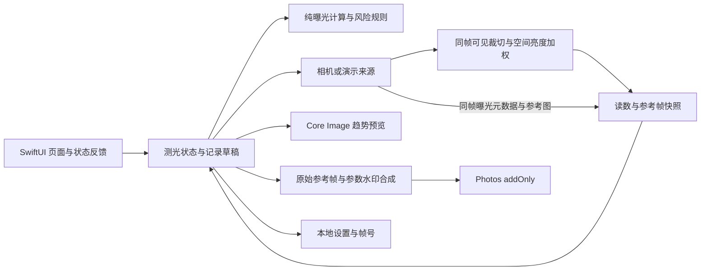

# LumaFrame 光格：技术与验收

版本：重设计开发版 0.1 · 日期：2026-10-30

本文规定计算契约、工程边界和验收方法。它不声称硬件精度、性能或发布条件已经通过。已执行命令及结果由工程 README/验证记录单独列出；下面未填结果的项目保持待验。

## 1. 平台与架构

产品目标为 iPhone、iOS 17+、SwiftUI，构建使用 Xcode 26 SDK。iOS 26 使用原生 Liquid Glass，iOS 17–25 回退为系统材质和标准按钮；降低透明度时采用实底。相机使用 AVFoundation；空间加权算法在 LumaCore 中运行；固定参考帧的亮暗趋势使用 Core Image；记录图由本地图像合成生成；Photos 仅添加新照片；设置使用本地持久化。无服务端和第三方统计依赖。早期另使用 Mac Catalyst 编译预览检查页面；这不是 iOS 模拟器，也不扩展为已完成的 Mac 正式产品。



逻辑职责需要隔离，具体文件组织以工程实际结构为准。曝光公式不依赖相机硬件、SwiftUI 或相册，因此可以运行确定性的领域测试。相机来源可以替换为明确标记的演示数据；演示不进入实测精度统计。

## 2. 曝光数学契约

### 2.1 输入与单位

| 符号 | 意义 | 单位/约束 |
|---|---|---|
| `Nc` | 相机镜头光圈 | f-number，有限且大于 0 |
| `tc` | 相机曝光时长 | 秒，有限且大于 0 |
| `Sc` | 相机 ISO | 有限且大于 0 |
| `Sf` | 胶卷 ISO / 曝光指数 | 有限且大于 0 |
| `Nu`、`tu` | 用户选择的光圈和快门 | 正值；快门使用秒，显示时再格式化 |
| `c` | 测光校准修正 | EV；加到原始 EV100 |
| `b` | 用户曝光补偿 | EV；正数代表希望比中性测光增加曝光 |
| `Yw` | 所选空间测光方式的加权线性亮度 | 归一化亮度；用于相对 0.18 的曝光修正，不是照度单位 |

光圈、快门时长和 ISO 必须有限且大于零；EV100、校准与补偿允许为零或负数，但必须有限。`ev100` 对无效输入返回 `nil`；`targetEV`/`deltaEV` 用 NaN 标识无效输入，非法 `solve` 保留设置并返回 NaN 残差和 `isLimited=true`。调用方必须先判断有效性，不可把 NaN 传给风险展示，也不能以 0EV 伪装测光成功。

### 2.2 基准、求解目标与实际偏移

```text
rawEV100 = log2(Nc² / tc) − log2(Sc / 100)
spatialCorrectionEV = log2(max(Yw, 0.000001) / 0.18)
calibratedEV100 = rawEV100 + spatialCorrectionEV + c
neutralEV = calibratedEV100 + log2(Sf / 100)

targetEV = neutralEV − b
userEV = log2(Nu² / tu)

actualDeltaEV = neutralEV − userEV
targetResidualEV = targetEV − userEV
```

`actualDeltaEV > 0` 表示用户组合相对中性测光增加曝光，趋势预览变亮；小于 0 则减少曝光。风险规则使用 `actualDeltaEV`。

`targetResidualEV` 用于解释 A/S 的档位取整与范围限制。它不是风险基准。设置 `+1EV` 补偿并准确求解时，`actualDeltaEV` 应约为 `+1EV`，`targetResidualEV` 应约为 0。

空间修正使用同一参考帧、同一可见裁切区域，不能把另一帧的亮度与当前曝光元数据拼接。0.18 是本实现的亮度参考常数，不是已经完成的设备标定；全黑输入采用数值下限只为防止无穷结果，不意味着该场景已得到可靠实测。

不应用隐藏的胶片偏置。胶片种类只影响提醒阈值。用户校准、用户创作补偿和实际曝光差采用不同名称与独立字段。正校准提高 EV100，求解时减少推荐曝光；正补偿降低求解目标 EV，增加推荐曝光。当前修改校准会清除旧读数，要求重新测光。

### 2.3 A/S/M 求解

```text
A 模式：保持 Nu，理想快门 tu = Nu² / 2^targetEV
S 模式：保持 tu，理想光圈 Nu = sqrt(tu × 2^targetEV)
M 模式：保留 Nu 与 tu；仅计算建议和 actualDeltaEV
```

A/S 在支持的离散档位中选择 EV 误差最小的值。不能直接用数值距离选快门，因为 1/1000 到 1/500 与 1s 到 2s 都是一档。超出范围时钳制到边界并返回范围提示和真实残差。

“采用建议”是显式操作。M 模式的测光、换胶片和读取新快照都不能自动改写光圈与快门。A/S 只改动自己的自动参数。

UI 将自动项呈现为只读，不改变 `selectedParameter`。选择或恢复 A/S 模式时同步编辑器：A 选光圈，S 选快门。补偿入口位于主界面，`Stepper` 按 1/3 档写入同一 `compensation` 状态；归零只重置补偿，不改变设备校准。M 仍只更新建议，主动采用后才应用。

用于曝光公式测试的例子：`Nc=2、tc=1/125s、Sc=100` 得到原始 `EV100≈8.966`。在空间加权亮度为 0.18、校准为 0 时，胶卷 ISO 400 的 `neutralEV≈10.966`；`Nu=4、tu=1/125s` 对应中性曝光，`actualDeltaEV≈0`。同条件把快门放慢到 `1/60s`，曝光增加约 1.059EV，符号必须为正。

### 2.4 exposureTargetOffset 的处理

原技术文档 §6.1 将 `exposureTargetOffset` 从 EV100 中减去，同时注明符号待真机验证。本轮不直接把该项放入公式，只接受自动曝光趋于稳定且目标偏移接近 0 的样本。

当前相机模块最多等待约 2 秒，每 100ms 检查一次；要求自动曝光不在调整、目标偏移绝对值小于 0.3EV、连续近似稳定比较达到 4 次（相邻差小于 0.15EV），且参考帧不超过 0.5 秒。预算内没有可接受样本则测光失败。这些是开发初始门槛，不能描述为行业标准或已通过真机准确性验证。

此策略减少未稳定读数带来的歧义，仍不能消除相机算法、色调映射、镜头、光源与场景反射率造成的系统误差。灰卡和参考表对比仍是发布前必需步骤。

### 2.5 空间测光契约

`MeteringMode` 与 `ExposureMode` 分离：前者决定区域权重，后者决定 A/S/M 自动求解哪一项。`MeteringPoint` 使用竖屏可见裁切画面的左上原点归一化坐标，x/y 范围为 0…1，非有限分量回到 0.5；点位置不跨启动持久化。

`LuminanceSampler.grid` 将同帧 BGRA 可见裁切区域划为 48 列 × 64 行等面积矩形，遍历区域内像素并计算线性亮度均值，再交给 `SpatialMetering.correction`。跨分区边界的像素按覆盖面积贡献，裁切外像素与行填充字节不参与；每格不再只取中心像素，从而减少细纹与采样位置对齐造成的漏采或混叠。通道线性化使用 256 项查找表；输入视为不透明 sRGB BGRA，忽略 alpha，亮度系数为 `0.2126R + 0.7152G + 0.0722B`。

区域均值仅在请求 capture 且已有稳定帧时执行，不加入每帧视频回调的持续计算。空间修正与输出参考帧使用同一可见裁切范围，避免用户点选位置和实际取样位置不一致。调用方保证缓冲区在同步采样期间有效；非法裁切、过短缓冲区、整数溢出或比像素区域更细的网格返回失败。该改动没有完成真机耗时或功耗测量。

| 方式 | 权重与实现 |
|---|---|
| 矩阵 | 对等面积区域的线性亮度均值等权汇总；不包含厂商专有场景识别或语义分类 |
| 中央重点 | 以可见画面短边为距离单位，中心高斯权重叠加外围底权；当前权重为 `1 + 4 × exp(-0.5 × (distance / 0.25)²)` |
| 点测光 | 圆区直径为可见画面短边的 16%；圆心钳制以保留完整圆区。当前以 8 个等面积环、每环 32 个角度采样汇总网格值，支持粗网格而不依赖圆内恰好存在格点中心 |

无效网格尺寸、数量、亮度或宽高比返回失败，不回退为伪造的 0EV。网格的 gamma 假设、设备处理后的色调映射、饱和/黑电平、镜头差异与曝光元数据时间差都可能影响结果；算法测试证明计算与状态契约，不证明硬件测光精度。

本轮 34 项核心测试通过，包括 14 项曝光、12 项空间加权及 8 项 BGRA 区域均值采样测试。执行与构建证据见[开发验证记录](04-开发验证记录.md)；计算测试不能代替相机硬件验收。

## 3. 经验提醒模型

本轮阈值以 `LumaCore/ExposureEngine.risk` 为准，调整了原技术文档中的部分旧值：

| 胶片类型 | 暗部风险，含边界 | 高光风险，含边界 |
|---|---|---|
| 彩色负片 | delta ≤ −2EV | delta ≥ +3EV |
| 反转片 | delta ≤ −1EV | delta ≥ +1EV |
| 黑白负片 | delta ≤ −2EV | delta ≥ +3EV |

绝对偏移严格小于 0.34EV 为接近基准；其余未到严重阈值的正/负偏移分别显示更亮/更暗。达到严重阈值才需要在记录预览确认，保存和分享均使用该确认。

这些数字不是胶片物理宽容度结论，也未针对品牌、批次、冲扫工艺或高反差场景校准。产品提示必须使用可能性表述。后续调整阈值时同步更新领域测试和交互文案。

风险确认绑定当前快照与参数草稿，至少包括快照标识、胶片类型、ISO、光圈、快门与校准条件。参数变化后重新评估；避免“同方向曾确认过”使新的较大风险被自动跳过。

本轮尚未实现独立慢快门提示。未来增加时应与曝光偏移分开，也不能只根据显示倍率或标称焦距就声称符合特定设备的手持安全快门。

## 4. 相机、快照与并发

- 相机会话的创建、配置、启动和停止使用明确的串行执行边界，避免阻塞主线程。
- UI 状态在主线程/主 Actor 更新；相机图像转换位于专用队列。趋势更新先合并 30ms 内的连续变化，再通过 `Task.detached` 在后台调用 `TrendRenderer`；调度器最多保留一项在途渲染和一个最新待处理请求。连续变化替换待处理请求，不创建相互重叠的渲染；递增 revision 拒绝过期结果。清除基准不会强行中断已经进入 Core Image 的工作，但该结果不能回填。真机延迟、功耗与内存仍需测量。
- 测光先发布读数与参考帧，不等待第一次 GPU 渲染。记录图合成目前仍由主 Actor 同步调用，其延迟、峰值内存与重复保存负载尚待设备验证。
- UI 使用系统 NavigationStack、语义颜色和原生控件，主题默认跟随系统，也可选择浅色/深色并持久化。取景高度约为可用区的 61%，限制为 300–500pt，辅助字号为 300pt；参数允许滚动，主按钮固定。iOS 26 对悬浮控件使用 `glassEffect`、`.glass` / `.glassProminent`，正文参数保留稳定底色；旧系统及降低透明度使用明确回退。视觉编译/预览与 iPhone 触控、辅助功能、性能验证分别记录。
- 主动选择可调光圈/快门后，通过 `ScrollViewReader` 对编辑器作最小必要滚动，遵循 Reduce Motion；默认取景尺寸不变。非零补偿在取景内显示通向同一补偿 Sheet 的入口，归零后收起。点位置选项保留在锁定后仍可打开的测光 Menu，选择后按同一模型方法清除旧读数。
- `CapturedReading` 包含已校准 EV100、参考图、采样时间、实际倍率、`lensTitle`、`meteringMode` 和 `meteringPoint`；来源在生成草稿时固定。修改校准、来源、镜头、测光方式或取样点会使活动读数失效。元数据曝光基准、空间样本与参考图取自同一稳定窗口。
- 采样缓冲区跨异步边界时确保生命周期安全；不得保存已经失效的底层指针。
- 参考图持有独立图像数据，避免每次调参重新抓取新帧；预览仅改变这张图的显示效果。
- 切换镜头/倍率、测光方式、点位置、会话中断、后台恢复、权限变化必须有明确状态，不能让旧画面冒充实时画面。当前用测光 revision 丢弃过期异步采样；相机拒绝、不可用或失败会清除活动基准。切镜头期间阻止测光与记录，运行态恢复效果仍需设备验收。
- 每次新测光先 `invalidateReading()`，失败后不保留旧快照的可记录状态。相机启停以 `desiredRunning` 表达最终意图，并以 lifecycle revision / pipeline generation 过滤旧启动结果、样本与状态回调；启动过程中的停止、再次启动不能靠旧任务结果覆盖最新意图。该防护已实现，快速前后台切换和系统中断仍待真实设备验证。
- 相机启动前后核验系统 `AVCaptureSession.isInterrupted`，并在恢复、切镜头和采样路径拒绝尚未解除的中断。内部状态不能因一次 `startRunning` 返回就把系统中断标成结束；旧样本仍按版本与时间门槛淘汰。中断通知和状态防护已补齐代码，实际恢复行为仍须真机测试。
- 真实相机发现可用后置广角、超广角、长焦，切换硬件镜头时在串行配置边界更换 `AVCaptureDeviceInput`。广角 1×为相对倍率基准；支持且没有近似 2×硬件镜头时增加 2×数码裁切路由。设备不可用或无法可靠计算标识时不虚构选项。
- iOS 26 通过设备 `nominalFocalLengthIn35mmFilm` 的有效值显示 35mm 标称焦距，并计算相对广角倍率；旧系统使用 `tan(wideFOV/2) / tan(lensFOV/2)` 估算相对倍率并标记“约”，不生成猜测的 mm 数值。最终显示和记录取自实际路由与 `videoZoomFactor` 回读。演示只有 1×/2×图像裁切，不能作为硬件焦距证据。
- 模拟器走明确的演示来源，所有界面和导出都保留演示标识；真机权限失败不静默变为演示实测。

玻璃实现依据：[Apple：为自定义视图应用 Liquid Glass](https://developer.apple.com/documentation/swiftui/applying-liquid-glass-to-custom-views)、[Apple：glassProminent](https://developer.apple.com/documentation/swiftui/primitivebuttonstyle/glassprominent)。设备标称焦距 API 的可用版本已按 Xcode SDK 头文件核对，不据此推定所有机型都返回有效焦距。

## 5. 图像与记录契约

趋势预览路径：`参考帧 → CIExposureAdjust(clamp(actualDeltaEV, −3, +3)) → 显示`。当前滤镜限于 ±3EV，UI 的 EV 差与风险规则仍使用真实数值；超出滤镜范围的亮暗图不能解释成完整曝光模拟。

记录路径：`未经趋势滤镜的参考帧 + 不可变记录草稿 → 水印图 → Photos`。不截图 UI，不把曝光趋势滤镜混入参考图，不宣称保存的是胶片成片。

草稿固定：图像、ISO、光圈、快门、EV 差、胶片类型、测光时间、帧号、来源、测光方式、镜头说明与点测位置。`RecordDraft.parameterSummary` 是生成草稿时写入的不可变文字，包含实际参数、时间、场景 EV100、方式和镜头说明；点测光还包含横纵百分比位置。它用于记录预览辅助标签与大字号文字，不从之后的可变设置重新组装。生成预览后，最终保存使用同一草稿。图像方向、裁切与水印必须与预览一致。

相册服务只申请 `.addOnly`。用途说明使用 `NSPhotoLibraryAddUsageDescription`；相机使用 `NSCameraUsageDescription`。不声明无关的麦克风、定位或完整照片库访问用途。

相册错误保留类型：`PhotoSaveFailure.denied` 才提供系统设置入口；普通写入失败统一映射 `.failed` 的中文重试/分享提示，不直接向用户显示系统 NSError 文案。保存调用与测试注入计数由 MainActor 隔离，等待系统异步回调时不阻塞界面。

记录页使用底部 `safeAreaInset` 固定保存/重试/继续及分享操作；正文包含风险 Toggle 与错误详情。未确认风险时禁止导出，底部“查看曝光提醒”通过滚动定位正文确认区，不修改确认状态；失败定位错误，成功提示留在固定区。此改动只调整呈现与操作位置，`RecordExporter.compose` 仍同步执行，不据此声称图像合成性能提升。

保存操作串行防重。仅在 Photos 确认成功后递增帧号；失败保留草稿和可重试图像，不能发出成功提示。`recordSaved` 先防止同一草稿重复处理，标记成功并推进帧号，随即 `invalidateReading()` 清除活动读数、趋势图与待处理请求，并使在途渲染结果失效。记录页以“继续取景”替换保存按钮，但草稿图保持可分享；点击继续、完成或下拉关闭时，主界面已无旧读数，不能重新编号保存同一参考帧。系统分享不推进帧号，即使用户在分享面板选择其他保存方式也不推断相册写入结果。已有照片不需要读取、修改或删除。

## 6. 状态与错误契约

| 状态/事件 | 必须保证 |
|---|---|
| 无相机授权 | 清楚解释用途；用户主动进入系统设置；不循环弹权限框 |
| 等待测光 | 禁止并发测光；先清除旧读数，记录不可用；有超时与重试，不先显示成功值 |
| 测光失败 | 保持无有效读数，不能退回旧快照继续记录；权限/会话/来源失效同样清除活动基准 |
| 已锁定 | 参数编辑只改设置和趋势；重新测光或返回实时取景会主动清除旧读数 |
| 模式切换或恢复 | 保持手动项；自动项按有效快照重算；无快照时不造推荐；A/S 编辑器始终指向可调项 |
| 测光方式切换 | 与 A/M/S 独立；清除旧读数与趋势并持久化新方式，须重新测光 |
| 点测位置变化 | 仅移动取样位置、不自动测量；保持圆区在画面内并清除旧基准；新启动回中心 |
| 镜头/倍率切换 | 清除旧基准；切换期间禁止采样，失败可恢复；只显示实际可用路由与回读值 |
| 补偿调整 | 主页显示当前值；按 1/3 档调整与归零；不与校准混用，M 不被暗中改写 |
| 参数超界 | 返回边界值、实际偏移和限制说明 |
| 保存前风险确认 | 确认与当前草稿绑定；更改草稿使确认失效 |
| 保存失败 | 不推进帧号，保留草稿并允许重试/分享；仅权限拒绝显示系统设置入口 |
| 保存成功 | 推进一次帧号并清除活动基准；保留当前导出草稿供分享，回到主界面后须重新测光 |
| 前后台切换 | 真实相机后台暂停并清除基准，恢复后重测；演示保留带标记的示例读数，避免 Mac 预览失焦重置；任何示例不标为实测 |
| 设置损坏 | 回退可用默认值；不因解析失败阻止进入 App |

## 7. 验收矩阵

以下列出要验证的行为，不表示已通过。当前确证的测试范围见《04-开发验证记录.md》；真机项目在没有硬件证据时保持待验。领域测试不自动覆盖同名 UI 状态、权限或草稿生命周期行为。

| 编号 | 范围 | 检查方法 | 通过条件 | 验证环境 |
|---|---|---|---|---|
| D01 | EV100 公式 | 固定输入领域测试 | 与解析结果一致，误差在数值容差内 | 本机测试 |
| D02 | EV 符号 | 快门加倍、ISO加倍、光圈整档变动 | 正负方向与曝光物理关系一致 | 本机测试 |
| D03 | 补偿与风险 | A/S 设置 +1EV 补偿 | 实际偏移约 +1EV，风险不归零 | 本机测试 |
| D04 | 模式联动 | M/A/S 状态测试 | M 不覆盖；A 仅快门自动；S 仅光圈自动 | 本机测试 |
| D05 | 边界求解 | 极暗/极亮及极值 | 有限合法值、范围提示、真实残差 | 本机测试 |
| D06 | 无效输入 | 0、负数、NaN、无穷 | 拒绝输入且不覆盖有效结果 | 本机测试 |
| D07 | 风险边界 | 各阈值上下与切换胶片 | 边界一致；确认适用于当前草稿 | 本机测试 |
| D08 | 空间测光 | 均匀/高反差网格、三种权重、边界点与非法输入 | 符合加权数学；点圆不越界；无效输入不假成功 | 本机测试 |
| D09 | BGRA 区域均值 | 细纹、非整除分区、裁切、行跨度和非法缓冲区 | 按线性亮度与面积正确汇总；不读裁切外或填充区域；非法输入拒绝 | 本机测试 |
| U01 | 首次路径 | 清空测试权限后启动 | 按需请求，相册不提前请求 | 模拟器/真机 |
| U02 | 演示隔离 | 模拟器运行与记录 | 演示标识持续可见且进入导出 | 模拟器 |
| U03 | 参数操作 | A/M/S、胶卷、参数编辑 | 值与「自动」状态一致，M 保留选择 | 模拟器/真机 |
| U04 | 冻结趋势 | 测光后移动手机并调参 | 显示固定参考帧；重测后才更新 | 真机 |
| U05 | 保存一致性 | 比较预览与导出 | 原始参考画面和参数一致，无趋势滤镜 | 模拟器/真机 |
| U06 | 保存失败 | 拒绝授权、模拟错误 | 保留草稿，不增帧号；普通失败可重试，仅拒绝授权指向设置 | 模拟器/真机 |
| U07 | 重复点击 | 保存过程中连点 | 一次提交、一张图、一次帧号推进 | 模拟器/真机 |
| U08 | 小屏与大字号 | 最小支持屏幕、最大辅助字号 | 主操作可到达、关键文本不丢失 | 模拟器/真机 |
| U09 | 辅助功能 | VoiceOver、对比度、减少动态等 | 完整主流程可操作且反馈可感知 | 真机为主 |
| U10 | 补偿入口 | 从主页调整、归零并关闭面板 | 当前值可见，A/S 重算；M 保留参数；读数说明可达 | 模拟器/真机 |
| U11 | 自动项与模式恢复 | 点击自动值、以 S 模式重启 | 自动值不抢编辑器；重启后快门仍可调 | 模拟器/真机 |
| U12 | 保存后继续 | 保存成功后分别继续、完成、下拉关闭 | 旧读数已清除，不得重编号重复记录；重新测光后可记下一张 | 模拟器/真机 |
| U13 | 重测失败 | 先成功测光，再让下一次采样失败 | 旧读数清除、记录禁用；重试成功后才可记录 | 模拟器注入/真机 |
| U14 | 记录参数可访问 | 对照草稿与辅助标签、大字号文字 | 实际参数一致、可读，不随当前设置变化 | 模拟器/VoiceOver 真机 |
| U15 | 测光方式与点位置 | 切三种方式、点击画面及位置菜单 | 与 A/M/S 独立；只移动取样点；旧读数清除；记录固定方式/位置 | 模拟器/真机 |
| U16 | 玻璃与回退 | iOS 26、旧系统、降低透明度、深浅色 | 控件可辨、命中区域充足；正文稳定；旧系统可用 | 模拟器/真机 |
| U17 | 主动调参与补偿可达 | SE 首屏点参数，设置非零补偿后从取景归零 | 编辑器可见；大取景默认不缩小；归零收起额外入口；遵循减少动态效果 | 模拟器/真机 |
| U18 | 固定记录操作 | 大字号保存、风险定位、失败与重试 | 操作固定可达；定位不自动确认；错误与成功反馈可发现；正文不被遮挡 | 模拟器/真机 |
| C01 | 稳定采样 | 多种场景、明暗切换 | 不稳定时不假成功；超时可恢复 | 真机 |
| C02 | 生命周期 | 后台恢复、启动前后系统中断、切镜头中断 | 未解除中断时拒绝恢复/切镜/采样；真正恢复后可重试，不显示伪实时状态 | 真机 |
| C03 | 镜头与倍率 | 单/多后摄设备，1×与2×裁切，快速切换 | 实际更换输入；能力准确；切换失败/中断可恢复，无假焦段 | 真机 |
| C04 | 点选与取样映射 | 横向/纵向明暗目标、不同裁切和镜头 | 显示圆区与取样区域一致，冻结帧和元数据对应 | 真机 |
| H01 | 灰卡校准 | 灰卡与参考表多光照对比 | 形成误差记录并据此确定发布口径 | 真机+参考设备 |
| H02 | 稳定性 | 连续运行与重复保存 | 无崩溃、持续内存增长和明显热失控 | 真机 |

故障注入仅在 `-ui-testing` 启动时生效：`-ui-testing-fail-remeasure` 让第 2 次测光失败，`-ui-testing-save-failure` 让首次保存失败而后续正常，`-ui-testing-save-denied` 模拟持续授权拒绝。它们验证状态与恢复路径，不能证明系统真实权限弹窗、相机中断或磁盘故障已经验收。

## 8. 真机校准与硬件待办

测试设备记录型号、iOS 版本、实际镜头/倍率、测光方式、点位置、校准值、光源、参考表型号与测量方式。每种可用硬件镜头分别校验，不能由广角结果推定超广角/长焦精度。灰卡填满所选测量区域，避免手遮挡、反光、混合光和明暗变化。每个条件至少连续采样五次，保存元数据曝光基准、空间亮度修正、最终 EV100 与参考值。

分别检查日光、室内连续光、暗光、高反差场景与可能闪烁的人工光。区分重复性和系统偏差：重复性差不能只用一个校准常数解决。参考表与 App 必须比较一致的反射式测光条件，不能把入射读数直接当作无条件真值。

误差统计完成前，原包提出的“±0.5EV 目标/±1EV 上限”只作为研究目标，不作为已达到的产品声明。需要根据实测结果决定支持范围、提示和是否适合反转片使用。

性能检查记录相机启动、测光等待、调参反馈、图像合成、Photos 保存时间以及长时间运行的温度和内存。模拟器速度不能代表 iPhone 性能；系统相册保存耗时应与本地合成耗时分开。

## 9. 构建与交付边界

本机可通过项目级 `DEVELOPER_DIR` 指向已安装 Xcode，避免为了本项目修改全局 `xcode-select`。真实可用 Xcode 版本、SDK、模拟器与命令以环境验证记录为准。

当前测试批次、通过数量和复测情况见[开发验证记录](04-开发验证记录.md)。Mac Catalyst 只是早期本地页面预览途径，不与 iOS 模拟器或实体 iPhone 证据混用。任何新增源码、资源或测试仅在实际重建/执行后更新相应结果，不能从早期成功推定最新状态。

模拟器构建无需把开发版描述为已签名真机发布包。真机安装仍依赖开发者团队、设备信任与签名配置。签名身份、Bundle ID、证书和 App Store Connect 操作属于发布阶段明确配置，不在文档里虚构。

## 10. 上架前必须补齐

1. 完成真机准确性、权限、中断、性能和无障碍矩阵，并保留证据。
2. 确认所有可见功能都有实现；移除演示残留的发布入口或明确演示用途。
3. 核对相机与照片添加用途说明、Privacy Manifest 以及实际使用的 Required Reason API 声明。
4. 以最终实现核对隐私标签、隐私政策和支持页面；不沿用未经复核的旧包文案。
5. 完成 App Icon、真实运行截图、版本号、版权、签名与发布配置。
6. 重新检查“测光精度”“胶片宽容度”“高光风险”等宣传是否有证据。

当前开发工程不等于 TestFlight 已分发或 App Store 已上架。没有实际执行记录时，不标记签名、上传、审核或发布完成。
